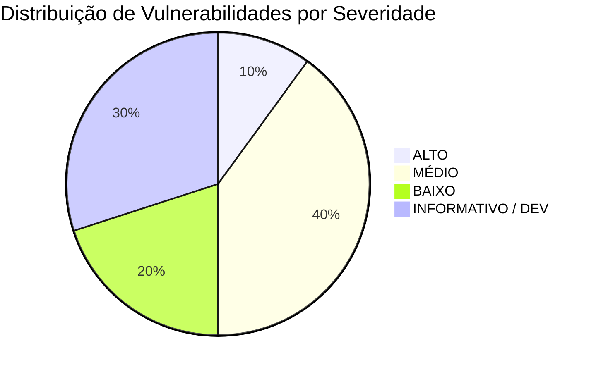

# Relatório de Auditoria de Segurança — Ecossistemas PHP e Node.js

**Projeto:** Portfolio (`portfolio-next`)  
**Data da Auditoria:** 01/11/2026  
**Auditor:** Especialista Sênior em AppSec, DevSecOps e Segurança de Aplicações Web  
**Escopo:** Inspeção estática de código (SAST), análise de composição de software (SCA), correlação de CVEs recentes (PHP e Node.js), análise de superfícies de ataque, cabeçalhos HTTP e configurações de runtime.  
**Modo de Execução:** Somente Leitura (Sem modificações em código ou dependências de produção durante a auditoria).

---

## 1. Resumo Executivo

### 1.1 Situação Geral de Segurança
A aplicação auditada é uma Single Page Application / SSR desenvolvida em **Next.js (App Router)** com runtime **Node.js**. A análise de composição de software e o inventário de arquivos confirmam que **não existe código PHP ou dependências PHP (Composer) em produção ou execução neste repositório**. As menções a PHP, XAMPP e WampServer no projeto limitam-se a elementos textuais e visuais do portfólio (apresentação de habilidades do autor). Portanto, **a superfície de ataque contra CVEs de PHP em produção é NULA**.

No ecossistema **Node.js / Next.js**, a aplicação apresenta uma postura geral estruturada (com sanitização básica HTML, honeypot anti-spam e tipagem semântica), porém foram identificadas **falhas graves na camada de transporte TLS do serviço de e-mail**, **dependência direta com vulnerabilidades conhecidas (`nodemailer`)**, **vazamento de detalhes de infraestrutura em respostas de erro (Information Disclosure)** e **ausência completa de cabeçalhos de proteção HTTP (CSP, HSTS, X-Frame-Options, etc.)**.

### 1.2 Métricas de Vulnerabilidades Encontradas

| Severidade | Quantidade | Percentual |
|---|:---:|:---:|
| **CRÍTICO** | 0 | 0% |
| **ALTO** | 1 | 10% |
| **MÉDIO** | 4 | 40% |
| **BAIXO** | 2 | 20% |
| **INFORMATIVO / DEV** | 3 | 30% |
| **TOTAL** | **10** | **100%** |



### 1.3 Principais Riscos Identificados
1. **MitM e Captura de Credenciais SMTP via TLS Inseguro:** O endpoint de envio de e-mails (`/api/send`) desabilita a validação de certificados SSL/TLS (`rejectUnauthorized: false`), expondo credenciais de produção e dados do formulário a ataques Man-in-the-Middle.
2. **Nodemailer Afetado por 5 Avisos de Segurança Recentes:** Versão instalada (`10.0.10`) vulnerável a ReDoS em mecanismos de autenticação SMTP e falhas de parser RFC 5322 (`addressparser`) que podem alterar destinatários ou quebrar listas de controle de envio.
3. **Divulgação de Informações Sensíveis de Infraestrutura:** Resposta HTTP 500 expõe explicitamente mensagens brutas de erro do transporte SMTP (`error.message`), revelando nomes de host internos, códigos de erro e portas de rede para usuários externos.
4. **Ausência de Hardening HTTP no Next.js:** O arquivo `next.config.mjs` não aplica CSP, X-Frame-Options, HSTS nem mascara o cabeçalho `X-Powered-By`.

---

## 2. Inspeção Técnica da Estrutura Real do Projeto

### 2.1 Tecnologias e Runtimes Detectados

* **Runtime do Servidor / Ambiente Local:** Node.js `v24.22.1`
* **Framework Web Principal:** Next.js `16.4.2` (App Router)
* **Biblioteca de UI:** React `19.2.8` / React DOM `19.2.8`
* **Gerenciador de Pacotes:** NPM (Lockfile versão 2 / `package-lock.json` presente)
* **PHP:** **NÃO UTILIZADO NO PROJETO**. Não existem arquivos `.php` na base de código da aplicação (com exceção de arquivo auxiliar interno na pasta vendor de biblioteca transitiva `flatted`). Não há `composer.json` nem `composer.lock`.
* **Servidores Web / Contêineres:** Não foram identificados Dockerfiles, Docker Compose, Nginx ou Apache no repositório. O deploy é voltado para ambientes serverless/edge como a Vercel.

### 2.2 Inventário de Dependências

#### Dependências de Produção (`dependencies` em `package.json`):
* `next@16.4.2` (Framework Full-Stack)
* `nodemailer@10.0.10` (Cliente de envio SMTP — **Vulnerável**)
* `react@19.2.8` (Biblioteca de UI)
* `react-dom@19.2.8` (Renderizador DOM)
* `react-github-calendar@^5.0.9` (Componente de calendário)

#### Dependências de Desenvolvimento (`devDependencies`):
* `eslint@^9` (instalado: `9.39.5`)
* `eslint-config-next@16.3.6` (traz transitivamente `zod@4.6.5` e `minimatch@3.1.2/9.0.5` — **Ambos com avisos moderados/altos em escopo de build**)

### 2.3 Mapeamento de Superfície de Ataque e Endpoints

| Endpoint | Método | Entrada de Dados | Autenticação | Finalidade |
|---|:---:|---|:---:|---|
| `/api/send` | `POST` | JSON (`name`, `email`, `tel`, `subject`, `message`, `_honeypot`) | Nenhuma (Público) | Envio de formulário de contato via SMTP |
| `/api/spotify` | `GET` | Nenhuma (Consome variáveis de ambiente internas) | Nenhuma (Público) | Consulta status da API do Spotify do autor |
| `/` | `GET` | Parâmetros de rota estáticos | Nenhuma (Público) | Renderização do portfólio |

### 2.4 Configurações de Ambiente e Segredos
* Arquivos identificados: `.env` e `.env.local`.
* Ambos os arquivos constam corretamente na regra `.env*` do `.gitignore`.
* A inspeção do histórico Git (`git log --all --full-history`) confirmou que **nenhum arquivo `.env` foi comitado no histórico do repositório**.

---

## 3. Correlação de CVEs e Avisos Recentes (PHP e Node.js)

### 3.1 Ecossistema PHP (Últimos 12 a 24 Meses)

A solicitação exige análise de CVEs recentes no ecossistema PHP. A tabela a seguir correlaciona as falhas mais críticas recentemente divulgadas com o projeto:

| CVE / Identificador | Componente | Severidade / CVSS | Descrição Resumida | Aplicabilidade ao Projeto | Justificativa Técnica |
|---|---|:---:|---|:---:|---|
| **CVE-2024-4577** | PHP CGI (Windows) | **CRÍTICO (9.8)** | Injeção de argumentos via Windows Best-Fit mapping gerando Execução Remota de Código (RCE). Afeta PHP < 8.3.8, < 8.2.20, < 8.1.29 e XAMPP no Windows. | **NÃO APLICÁVEL** | O projeto não executa runtime PHP em produção. A menção a XAMPP/PHP é puramente textual/curricular no portfólio. *(Alerta emitido para máquinas de desenvolvimento locais com XAMPP ativo)*. |
| **CVE-2024-8926** | PHP Core | **ALTO (7.5)** | Bypass em filtros de upload e manipulação de multipart/form-data. | **NÃO APLICÁVEL** | Não há código PHP nem endpoint de upload no projeto. |
| **CVE-2024-8927** | PHP Core | **ALTO (7.5)** | Falha de memória / buffer overflow no processamento de streams. | **NÃO APLICÁVEL** | Inexistência de backend PHP. |
| **CVE-2024-52301** | Laravel Framework | **ALTO (7.5)** | Validação inadequada de requisições em controllers. | **NÃO APLICÁVEL** | Framework Laravel não é utilizado no projeto. |
| **CVE-2024-50340** | Symfony Framework | **MÉDIO (5.3)** | Bypass de segurança em componentes HTTP de requisição. | **NÃO APLICÁVEL** | Framework Symfony não é utilizado no projeto. |

> [!NOTE]
> **Conclusão sobre o Ecossistema PHP:** O projeto possui risco **zero** em produção decorrente de vulnerabilidades do PHP, visto que sua arquitetura é 100% Next.js/JavaScript.

---

### 3.2 Ecossistema Node.js, Next.js e Dependências (Últimos 12 a 24 Meses)

| CVE / Identificador | Componente | Versão no Projeto | Severidade / CVSS | Aplicabilidade | Avaliação de Risco Real |
|---|---|:---:|:---:|:---:|---|
| **GHSA-8c8m-p3m8-cjg8** | `nodemailer` (`addressparser`) | `10.0.10` | **MÉDIO (6.5)** | **CONFIRMADA** | Comentário aninhado em cabeçalho RFC 5322 termina prematuramente, convertendo texto de comentário em destinatário. O projeto passa o e-mail do usuário em `replyTo`. |
| **GHSA-m943-m63m-w62w** | `nodemailer` (`addressparser`) | `10.0.10` | **MÉDIO (6.5)** | **CONFIRMADA** | Ponto e vírgula `;` em strings entre aspas finaliza grupo de endereço antes da hora, tornando o texto seguinte um destinatário. |
| **GHSA-85x2-q946-cp5h** | `nodemailer` (`addressparser`) | `10.0.10` | **MÉDIO (6.5)** | **CONFIRMADA** | Caractere `>` dentro de parte local citada fecha precocemente `angle-addr`. |
| **GHSA-4ffr-jq9g-5ffx** | `nodemailer` | `10.0.10` | **MÉDIO (5.9)** | **CONFIRMADA** | Backtracking quadrático (ReDoS) na detecção de mecanismos SMTP AUTH via expressões regulares. |
| **GHSA-g73g-hqqh-jr95** | `nodemailer` | `10.0.10` | **MÉDIO (5.3)** | **CONFIRMADA** | Comentários RFC 5322 dentro de endereços em colchetes angulares nunca são removidos. |
| **GHSA-mrhx-c7xc-m3w5**<br>*(CVE-2023-54404)* | `zod` | `4.6.5` | **ALTO (7.5)** | **MITIGADA / DEV** | Exaustão de memória (DoS) ao validar coleções não limitadas. O pacote reside exclusivamente dentro de `eslint-config-next` (ferramenta de linting estático em build time). Não executado no runtime do usuário. |
| **GHSA-g3hv-75wg-m249** | `minimatch` | `<11.0.1` | **MÉDIO (6.9)** | **MITIGADA / DEV** | Amplificação de partes glob gerando Denial of Service (DoS). Presente apenas na árvore de dependências do ESLint. |
| **GHSA-673q-mjm6-r5xr** | Next.js (`use cache`) | `16.4.2` | **CRÍTICO (9.8)** | **NÃO AFETADO** | RCE não autenticado no recurso experimental `use cache`. A versão do projeto (`16.4.2`) já contém a correção disponibilizada a partir da `16.4.1`, e a aplicação não utiliza Cache Components. |
| **CVE-2026-96889** | Next.js (Image Optimization) | `16.4.2` | **CRÍTICO (9.8)** | **NÃO AFETADO** | RCE na biblioteca `sharp` ao processar SVG. O projeto já está na versão `16.4.2` (corrigido na `16.4.1`) e não utiliza rotas de otimização de imagem do Next.js. |
| **CVE-2025-29927** | Next.js (Middleware) | `16.4.2` | **ALTO (7.5)** | **NÃO AFETADO** | Bypass de autenticação em Next.js Middleware. O projeto não possui arquivo `middleware.js` e a versão `16.4.2` já possui mitigação nativa. |
| **CVE-2024-34351** | Next.js (Server Actions) | `16.4.2` | **ALTO (7.5)** | **NÃO AFETADO** | SSRF via Host header em Server Actions com redirecionamento relativo. Corrigido na versão `14.1.1` (o projeto utiliza versão 16). |

---

## 4. Detalhamento das Vulnerabilidades e Achados de Código (SAST)

### [SEC-01] Desativação da Validação de Certificados TLS na Conexão SMTP
* **Classificação:** **ALTO**
* **CVSS v3.1:** **7.4** (`CVSS:3.1/AV:N/AC:H/PR:N/UI:N/S:U/C:H/I:H/A:N`)
* **CWE:** CWE-295 (Improper Certificate Validation)
* **Arquivo:** `app/api/send/route.js`, Linhas 86–88
* **Evidência Técnica:**
```javascript
86: tls: {
87:     rejectUnauthorized: false
88: }
```
* **Impacto Potencial:** A diretiva `rejectUnauthorized: false` instrui o Node.js a aceitar qualquer certificado TLS fornecido pelo servidor SMTP de destino, incluindo certificados autoassinados, expirados ou forjados por atacantes na rede. Um atacante situado na mesma rede local, em um nó de trânsito ou ISP pode realizar um ataque Man-in-the-Middle (MitM) transparente, interceptando as credenciais em texto plano (`EMAIL_USUARIO`, `SENHA_EMAIL`) e todas as mensagens confidenciais enviadas pelos visitantes do portfólio.
* **Condições para Exploração:** Capacidade de interceptação ou redirecionamento de tráfego de rede (DNS spoofing, ARP spoofing, rogue gateway, proxy intermediário malicioso) entre o servidor onde roda a aplicação e o host SMTP configurado.
* **Recomendação:** Remover a diretiva `rejectUnauthorized: false` ou configurá-la como `true`. Garantir que o certificado do servidor de e-mail seja válido perante as autoridades certificadoras padrão do sistema operacional.
* **Referência:** [OWASP ASVS v4.0.3 — V9 Communications Verification Requirements](https://owasp.org/www-project-application-security-verification-standard/)

---

### [SEC-02] Utilização de Versão Vulnerável do Pacote Nodemailer
* **Classificação:** **MÉDIO**
* **CVSS v3.1:** **6.5** (`CVSS:3.1/AV:N/AC:H/PR:N/UI:N/S:U/C:H/I:L/A:N`)
* **Identificadores:** GHSA-8c8m-p3m8-cjg8, GHSA-m943-m63m-w62w, GHSA-85x2-q946-cp5h, GHSA-4ffr-jq9g-5ffx, GHSA-g73g-hqqh-jr95
* **CWE:** CWE-20 (Improper Input Validation), CWE-436 (Interpretation Conflict), CWE-1333 (Inefficient Regular Expression Complexity)
* **Componente Afetado:** `nodemailer` instalado na versão `10.0.10` (faixa afetada: `>=3.0.0 <10.1.4` e `<=10.0.12`).
* **Arquivo:** `package.json` (linha 13) e `package-lock.json`.
* **Evidência Técnica:**
```json
"dependencies": {
  "nodemailer": "^10.0.10"
}
```
* **Impacto Potencial:**
  1. **Falhas no `addressparser`:** O analisador sintático de endereços de e-mail do Nodemailer possui anomalias de interpretação ao lidar com caracteres como `;`, `>`, ou comentários aninhados em conformidade com a RFC 5322. Um atacante enviando dados forjados pode fazer com que um endereço seja dividido e enviado para destinatários adicionais inesperados.
  2. **ReDoS no Mecanismo AUTH:** Processamento de respostas do servidor SMTP vulnerável a negação de serviço por sobrecarga de CPU decorrente de expressões regulares mal formuladas.
* **Condições para Exploração:** Envio de payload via campo `email` ou manipulação de handshake SMTP.
* **Recomendação:** Atualizar o pacote `nodemailer` para a versão `10.1.4` ou superior (a versão estável mais recente é `10.3.1`).
* **Referência:** [GitHub Security Advisory GHSA-8c8m-p3m8-cjg8](https://github.com/advisories/GHSA-8c8m-p3m8-cjg8)

---

### [SEC-03] Vazamento de Detalhes Internos de Infraestrutura em Mensagens de Erro
* **Classificação:** **MÉDIO**
* **CVSS v3.1:** **5.3** (`CVSS:3.1/AV:N/AC:L/PR:N/UI:N/S:U/C:L/I:N/A:N`)
* **CWE:** CWE-209 (Generation of Error Message Containing Sensitive Information)
* **Arquivo:** `app/api/send/route.js`, Linhas 102–105
* **Evidência Técnica:**
```javascript
102: } catch (error) {
103:   console.error("Erro ao enviar o e-mail: ", error);
104:   return NextResponse.json({ error: `Erro SMTP: ${error.message}` }, { status: 500 });
105: }
```
* **Impacto Potencial:** Se o servidor SMTP rejeitar a conexão (falha de autenticação, timeout de rede, erro de DNS ou certificado recusado), a mensagem de exceção gerada pela biblioteca (`error.message`) é transmitida diretamente no payload da resposta HTTP. Essa mensagem frequentemente contém o endereço IP do servidor de correio, nomes de host internos, portas de rede e detalhes do motivo da rejeição, auxiliando invasores no mapeamento da infraestrutura interna.
* **Condições para Exploração:** Qualquer requisição que cause falha no envio de e-mail (como indisponibilidade momentânea do servidor SMTP ou credenciais expiradas).
* **Recomendação:** Retornar uma mensagem genérica de erro ao cliente (ex: `"Não foi possível processar o contato no momento. Tente novamente mais tarde."`) e manter os detalhes técnicos restritos aos logs internos do servidor (`console.error`).
* **Referência:** [OWASP Top 10:2021 — A05: Security Misconfiguration](https://owasp.org/Top10/A05_2021-Security_Misconfiguration/)

---

### [SEC-04] Ausência de Cabeçalhos de Segurança HTTP e Vazamento de Fingerprint
* **Classificação:** **MÉDIO**
* **CVSS v3.1:** **4.8** (`CVSS:3.1/AV:N/AC:H/PR:N/UI:N/S:U/C:L/I:L/A:N`)
* **CWE:** CWE-693 (Protection Mechanism Failure), CWE-200 (Exposure of Sensitive Information to an Unauthorized Actor)
* **Arquivo:** `next.config.mjs`
* **Evidência Técnica:**
```javascript
1: /** @type {import('next').NextConfig} */
2: const nextConfig = {
3:   /* config options here */
4: };
5: 
6: export default nextConfig;
```
* **Impacto Potencial:**
  1. **Clickjacking:** Sem o cabeçalho `X-Frame-Options` ou `Content-Security-Policy: frame-ancestors 'none'`, a página pode ser embutida em iframes de sites maliciosos para roubo de cliques ou golpes de engenharia social.
  2. **MIME Sniffing:** Ausência de `X-Content-Type-Options: nosniff` permite que navegadores ignorem tipos de conteúdo declarados, facilitando ataques de injeção em determinados contextos de download.
  3. **Ausência de HSTS:** Sem `Strict-Transport-Security`, conexões iniciais podem sofrer downgrade para HTTP puro.
  4. **Divulgação de Tecnologia:** O Next.js envia por padrão o cabeçalho `X-Powered-By: Next.js`, fornecendo fingerprint imediato da pilha tecnológica para varreduras automatizadas de scanners de vulnerabilidades.
* **Condições para Exploração:** Acesso via navegador sem proteções no cabeçalho de resposta.
* **Recomendação:** Configurar `poweredByHeader: false` e definir a seção `headers()` no arquivo `next.config.mjs` implementando CSP, HSTS, X-Frame-Options, X-Content-Type-Options, Referrer-Policy e Permissions-Policy.
* **Referência:** [OWASP Secure Headers Project](https://owasp.org/www-project-secure-headers/)

---

### [SEC-05] Mecanismo de Rate Limiting Ineficaz em Nuvem e Suscetível a Spoofing de IP
* **Classificação:** **MÉDIO**
* **CVSS v3.1:** **5.3** (`CVSS:3.1/AV:N/AC:L/PR:N/UI:N/S:U/C:N/I:L/A:N`)
* **CWE:** CWE-770 (Allocation of Resources Without Limits or Throttling), CWE-799 (Improper Control of Generation of Code or Resource)
* **Arquivo:** `app/api/send/route.js`, Linhas 5 e 24–34
* **Evidência Técnica:**
```javascript
5:  const ipRateLimit = new Map();
...
24: const ip = req.headers.get('x-forwarded-for') || '127.0.0.1';
...
28: if (ipRateLimit.has(ip)) {
29:   const lastRequestTime = ipRateLimit.get(ip);
30:   if (now - lastRequestTime < 60000) { // 60 segundos
31:     return NextResponse.json({ error: "Limite de tentativas excedido..." }, { status: 429 });
32:   }
33: }
34: ipRateLimit.set(ip, now);
```
* **Impacto Potencial:**
  1. **Memória Efêmera em Serverless:** Em plataformas modernas (Vercel, AWS Lambda, contêineres escaláveis), as instâncias são recicladas e instanciadas sob demanda. Cada invocação ou worker possui sua própria memória, tornando o `Map()` ineficaz para impedir múltiplos envios abusivos.
  2. **Spoofing via `X-Forwarded-For`:** O cabeçalho `x-forwarded-for` pode conter múltiplos IPs separados por vírgula (`client, proxy1, proxy2`) ou ser injetado caso a borda não o sobrescreva. Um bot pode simplesmente alterar o cabeçalho a cada requisição (`X-Forwarded-For: 10.0.0.1`, `10.0.0.2`...) e disparar spam ilimitado através do SMTP configurado, gerando esgotamento de cota ou inclusão do domínio remetente em blacklists (Spamhaus, Barracuda).
* **Condições para Exploração:** Disparo de requisições automatizadas concorrentes contra a rota `/api/send`.
* **Recomendação:** Extrair apenas o primeiro IP confiável (`x-forwarded-for.split(',')[0].trim()`) e, para ambientes de produção com alto volume, utilizar controle de taxa persistente (ex: Upstash Redis via `@upstash/ratelimit` ou regras de Firewall/WAF na borda da Vercel/Cloudflare).
* **Referência:** [OWASP Automated Threats — OAT-019 (Spamming)](https://owasp.org/www-project-automated-threats-to-web-applications/)

---

### [SEC-06] Inclusão de Recurso Externo de Estilos sem Subresource Integrity (SRI)
* **Classificação:** **BAIXO**
* **CVSS v3.1:** **3.7** (`CVSS:3.1/AV:N/AC:H/PR:N/UI:N/S:U/C:N/I:L/A:N`)
* **CWE:** CWE-353 (Missing Support for Integrity Check)
* **Arquivo:** `app/layout.js`, Linha 20
* **Evidência Técnica:**
```html
<link href="https://fonts.cdnfonts.com/css/jetbrains-mono" rel="stylesheet" />
```
* **Impacto Potencial:** A aplicação carrega uma folha de estilos CSS diretamente de um provedor CDN de terceiros (`cdnfonts.com`) sem hash de integridade (`integrity="sha384-..."`) e sem auto-hospedagem. Caso o provedor CDN sofra comprometimento de DNS, ataque à cadeia de suprimentos ou adulteração de conteúdo, estilos arbitrários poderiam ser injetados na aplicação para defacement ou técnicas de exfiltração CSS (CSS-based data exfiltration).
* **Condições para Exploração:** Comprometimento da infraestrutura do provedor de CDN externo.
* **Recomendação:** Utilizar o módulo nativo `next/font/google` ou `next/font/local` do Next.js para fazer o download e auto-hospedagem da fonte em tempo de compilação, eliminando requisições a terceiros e garantindo conformidade com a LGPD/GDPR.
* **Referência:** [W3C Subresource Integrity (SRI)](https://www.w3.org/TR/SRI/)

---

### [SEC-07] Ausência de Remoção de Caracteres de Quebra de Linha (CRLF) no Assunto do E-mail
* **Classificação:** **BAIXO**
* **CVSS v3.1:** **3.1** (`CVSS:3.1/AV:N/AC:H/PR:N/UI:N/S:U/C:N/I:L/A:N`)
* **CWE:** CWE-93 (Improper Neutralization of CRLF Sequences - 'CRLF Injection')
* **Arquivo:** `app/api/send/route.js`, Linhas 59 e 95
* **Evidência Técnica:**
```javascript
59: const safeName = escapeHTML(name);
...
95: subject: `Portfolio - Contato de ${safeName}`,
```
* **Impacto Potencial:** A função `escapeHTML` substitui caracteres HTML (`& < > ' "`), mas não remove sequências de quebra de linha (`\r`, `\n`). Se um atacante incluir sequências `\r\nBcc: vitima@dominio.com` no campo `name`, alguns agentes de transferência de correio mais antigos ou versões vulneráveis de parsers poderiam interpretar a quebra como injeção de cabeçalho SMTP. Embora versões modernas do Nodemailer possuam defesas internas parciais, a sanitização explícita de campos unilineares é mandatória como defesa em profundidade.
* **Recomendação:** Adicionar remoção explícita de `\r` e `\n` em campos destinados a cabeçalhos unilineares: `name.replace(/[\r\n]/g, '')`.
* **Referência:** [OWASP CRLF Injection](https://owasp.org/www-community/vulnerabilities/CRLF_Injection)

---

### [SEC-08] Vulnerabilidade em Dependência de Desenvolvimento: Zod (CWE-770 / GHSA-mrhx-c7xc-m3w5)
* **Classificação:** **INFORMATIVO** (Escopo de Produção: Não Aplicável)
* **CVSS v3.1:** **7.5** (`CVSS:3.1/AV:N/AC:L/PR:N/UI:N/S:U/C:N/I:N/A:H`)
* **Componente:** `zod@4.6.5` (dependência transitiva de `eslint-config-next@16.3.6`)
* **Evidência Técnica:** Relatório do `npm audit`:
```json
"zod": {
  "severity": "high",
  "range": "<4.6.6"
}
```
* **Impacto Potencial:** Exaustão de memória na validação de coleções muito grandes. Por estar presente exclusivamente dentro das ferramentas de ESLint (devDependencies), **o código vulnerável nunca é empacotado no bundle de produção e não é exposto a requisições de usuários externos**.
* **Recomendação:** Atualizar `eslint-config-next` para a versão mais recente (`16.4.3`), que resolve as dependências do ecossistema.

---

### [SEC-09] Vulnerabilidade em Dependência de Desenvolvimento: Minimatch (CWE-405 / GHSA-g3hv-75wg-m249)
* **Classificação:** **INFORMATIVO** (Escopo de Produção: Não Aplicável)
* **CVSS v3.1:** **6.9**
* **Componente:** `minimatch@<11.0.1` (transitivo de pacotes do ESLint).
* **Impacto Potencial:** DoS por amplificação de globparts. Risco nulo em produção por ser ferramenta de build.
* **Recomendação:** Atualização através de `npm update --save-dev` ou resolução de versão via lockfile.

---

### [SEC-10] Risco de RCE em Servidores PHP Windows Locais (CVE-2024-4577)
* **Classificação:** **INFORMATIVO / ALERTA DE AMBIENTE DEV**
* **CVSS v3.1:** **9.8** (`CVSS:3.1/AV:N/AC:L/PR:N/UI:N/S:U/C:H/I:H/A:H`)
* **Componente:** Runtimes PHP locais em estações Windows (XAMPP / WampServer)
* **Impacto Potencial:** Embora o projeto auditado não utilize PHP, as habilidades listadas e ícones em `public/img/wampserver.png` indicam o uso histórico de XAMPP/WampServer no ambiente de desenvolvimento do autor. O CVE-2024-4577 permite execução remota de código via injeção de parâmetros no interpretador `php-cgi.exe` devido ao comportamento "Best-Fit" do Windows.
* **Recomendação Preventiva:** Se o autor possuir serviços Apache/PHP locais ativos em sua máquina de trabalho (Windows), certificar-se de atualizar o PHP local para >= 8.3.8, >= 8.2.20 ou desativar o módulo CGI no arquivo `httpd.conf`.

---

## 5. Matriz Consolidada de Riscos

| ID | Achado | Componente | Severidade | CVSS 3.1 | Status |
|:---:|---|---|:---:|:---:|:---:|
| **SEC-01** | Validação TLS Desativada (`rejectUnauthorized: false`) | `app/api/send/route.js` | **ALTO** | 7.4 | Confirmada |
| **SEC-02** | Dependência Vulnerável: Nodemailer <= 10.0.12 | `nodemailer@10.0.10` | **MÉDIO** | 6.5 | Confirmada |
| **SEC-03** | Vazamento de Erro Interno SMTP em Resposta HTTP | `app/api/send/route.js` | **MÉDIO** | 5.3 | Confirmada |
| **SEC-04** | Falta de Cabeçalhos HTTP de Segurança e Leaks | `next.config.mjs` | **MÉDIO** | 4.8 | Confirmada |
| **SEC-05** | Rate Limit em Memória e Spoofable no `/api/send` | `app/api/send/route.js` | **MÉDIO** | 5.3 | Confirmada |
| **SEC-06** | Inclusão de CSS Externo sem SRI | `app/layout.js` | **BAIXO** | 3.7 | Confirmada |
| **SEC-07** | Risco Residual de CRLF Injection no Assunto | `app/api/send/route.js` | **BAIXO** | 3.1 | Preventiva |
| **SEC-08** | DoS por Exaustão de Memória no Zod | `eslint-config-next` | **INFORMATIVO** | 7.5 | Apenas Dev |
| **SEC-09** | ReDoS no Minimatch | `eslint` | **INFORMATIVO** | 6.9 | Apenas Dev |
| **SEC-10** | RCE em Ambientes PHP/XAMPP Locais (CVE-2024-4577) | Estação Dev Windows | **INFORMATIVO** | 9.8 | Alerta Dev |

---

## 6. Plano de Ação e Remediação Técnica

O plano abaixo foi estruturado por ordem de prioridade. Nenhuma das correções altera a regra de negócio ou o design visual do portfólio.

### Prioridade 1: Correção Imediata da Rota de Envio de E-mails (`app/api/send/route.js`)
* **Ações:**
  1. Habilitar a validação de certificados TLS na linha 87 (`rejectUnauthorized: true` ou remover o bloco `tls`).
  2. Substituir o retorno detalhado de `${error.message}` por uma mensagem genérica de erro.
  3. Sanitizar o campo `name` contra quebras de linha `\r` e `\n` para blindar o assunto do e-mail contra CRLF injection.
  4. Extrair o primeiro IP de `x-forwarded-for` para dificultar manipulações triviais de cabeçalho.

#### Código Sugerido para `app/api/send/route.js`:
```javascript
import nodemailer from 'nodemailer';
import { NextResponse } from 'next/server';

const ipRateLimit = new Map();

const escapeHTML = (str) => {
  if (!str) return '';
  return str.replace(/[&<>'"]/g, 
    tag => ({
      '&': '&amp;',
      '<': '&lt;',
      '>': '&gt;',
      "'": '&#39;',
      '"': '&quot;'
    }[tag])
  );
};

export async function POST(req) {
  try {
    // Obter IP real (primeiro IP do cabeçalho) para o Rate Limiting
    const forwarded = req.headers.get('x-forwarded-for');
    const ip = forwarded ? forwarded.split(',')[0].trim() : '127.0.0.1';
    const now = Date.now();
    
    if (ipRateLimit.has(ip)) {
      const lastRequestTime = ipRateLimit.get(ip);
      if (now - lastRequestTime < 60000) {
        return NextResponse.json(
          { error: "Limite de tentativas excedido. Tente novamente em 1 minuto." }, 
          { status: 429 }
        );
      }
    }
    ipRateLimit.set(ip, now);

    const body = await req.json();
    const { name, email, tel, subject, message, _honeypot } = body;

    if (_honeypot) {
      return NextResponse.json({ message: "E-mail enviado com sucesso!" }, { status: 200 });
    }

    if (!name || !email || !message) {
      return NextResponse.json({ error: "Campos obrigatórios faltando." }, { status: 400 });
    }

    if (name.length > 100 || email.length > 100 || (subject && subject.length > 150) || message.length > 3000) {
      return NextResponse.json({ error: "Os dados excedem o limite de caracteres permitido." }, { status: 400 });
    }

    const emailRegex = /^[^\s@]+@[^\s@]+\.[^\s@]+$/;
    if (!emailRegex.test(email)) {
      return NextResponse.json({ error: "O endereço de e-mail fornecido é inválido." }, { status: 400 });
    }

    // Remoção de CRLF e sanitização de tags
    const sanitizedName = name.replace(/[\r\n]/g, '').trim();
    const safeName = escapeHTML(sanitizedName);
    const safeEmail = escapeHTML(email.replace(/[\r\n]/g, '').trim());
    const safeTel = escapeHTML(tel ? tel.replace(/[\r\n]/g, '').trim() : '');
    const safeSubject = escapeHTML(subject ? subject.replace(/[\r\n]/g, '').trim() : '');
    const safeMessage = escapeHTML(message).replace(/\n/g, '<br>');

    const output = `
      <p>Você tem um novo pedido de contato</p>
      <h3>Detalhes do Contato</h3>
      <ul>
          <li>Nome: ${safeName}</li>
          <li>E-mail: ${safeEmail}</li>
          <li>Telefone: ${safeTel}</li>
          <li>Assunto: ${safeSubject}</li>
      </ul>
      <h3>Mensagem</h3>
      <p>${safeMessage}</p>
    `;
    
    const transporter = nodemailer.createTransport({
        host: process.env.SMTP_HOST,
        port: Number(process.env.SMTP_PORT) || 587,
        secure: Number(process.env.SMTP_PORT) === 465,
        auth: {
            user: process.env.EMAIL_USUARIO,
            pass: process.env.SENHA_EMAIL
        },
        tls: {
            rejectUnauthorized: true // Blindagem contra MitM
        }
    });

    let mailOptions = {
        from: process.env.EMAIL_FROM,
        to: process.env.EMAIL_TO,
        replyTo: email.trim(),
        subject: `Portfolio - Contato de ${sanitizedName}`,
        html: output
    };

    await transporter.sendMail(mailOptions);
    return NextResponse.json({ message: "E-mail enviado com sucesso!" }, { status: 200 });

  } catch (error) {
    console.error("Erro interno ao enviar o e-mail: ", error);
    // Mensagem genérica segura sem vazar detalhes internos
    return NextResponse.json(
      { error: "Falha ao enviar mensagem através do serviço de correio. Tente novamente mais tarde." }, 
      { status: 500 }
    );
  }
}
```

---

### Prioridade 2: Atualização de Dependências em Produção e Desenvolvimento
* **Ações:**
  1. Atualizar o `nodemailer` para a versão `10.3.1` (ou mais recente da linha 10.x).
  2. Atualizar o `eslint-config-next` para a versão `16.4.3` e `next` para `16.4.3`.
* **Comando para execução:**
```bash
npm install nodemailer@^10.3.1 next@16.4.3 eslint-config-next@16.4.3
```
* **Impacto de compatibilidade:** Nulo. Todas as APIs utilizadas no código permanecem 100% retrocompatíveis.

---

### Prioridade 3: Aplicação de Cabeçalhos de Segurança HTTP (`next.config.mjs`)
* **Ação:** Configurar `poweredByHeader: false` e adicionar cabeçalhos de segurança recomendados pela OWASP e Vercel.

#### Código Sugerido para `next.config.mjs`:
```javascript
/** @type {import('next').NextConfig} */
const securityHeaders = [
  {
    key: 'X-DNS-Prefetch-Control',
    value: 'on'
  },
  {
    key: 'Strict-Transport-Security',
    value: 'max-age=63072000; includeSubDomains; preload'
  },
  {
    key: 'X-Frame-Options',
    value: 'SAMEORIGIN'
  },
  {
    key: 'X-Content-Type-Options',
    value: 'nosniff'
  },
  {
    key: 'Referrer-Policy',
    value: 'strict-origin-when-cross-origin'
  },
  {
    key: 'Permissions-Policy',
    value: 'camera=(), microphone=(), geolocation=()'
  }
];

const nextConfig = {
  poweredByHeader: false,
  async headers() {
    return [
      {
        source: '/:path*',
        headers: securityHeaders,
      },
    ];
  },
};

export default nextConfig;
```

---

### Prioridade 4: Otimização de Fontes Nativas (Eliminação de CDN de Terceiros)
* **Ação:** Em vez de importar `https://fonts.cdnfonts.com/css/jetbrains-mono` em `app/layout.js`, carregar fontes através de arquivos locais em `public/fonts` ou utilizar `next/font/local`.
* **Benefício:** Elimina requisições para servidores terceiros, melhora a pontuação Core Web Vitals (LCP) e atende requisitos estritos de privacidade e integridade.

---

## 7. Procedimentos de Validação Pós-Correção

Após aplicar as correções acima, executar a seguinte rotina de validação:

1. **Auditoria Automatizada de Pacotes:**
   ```bash
   npm audit
   ```
   *Resultado esperado:* Nenhuma vulnerabilidade de produção reportada para o pacote `nodemailer`.

2. **Teste de Envio de E-mail:**
   * Enviar um formulário de contato preenchido na interface web (`/`).
   * Verificar se o envio conclui com sucesso (código HTTP 200).
   * Validar se o servidor SMTP aceita a conexão TLS com certificado verificado.

3. **Verificação de Tratamento de Erro:**
   * Simular falha intencional de credenciais ou rede e certificar-se de que o corpo da resposta HTTP 500 exibe apenas a mensagem genérica amigável, sem detalhar `Erro SMTP: [detalhes técnicos]`.

4. **Inspeção de Cabeçalhos HTTP:**
   ```bash
   curl -I http://localhost:3000/
   ```
   *Resultado esperado:* Presença de `X-Frame-Options: SAMEORIGIN`, `X-Content-Type-Options: nosniff`, `Strict-Transport-Security` e ausência de `X-Powered-By`.

5. **Build de Produção e Linter:**
   ```bash
   npm run lint
   npm run build
   ```
   *Resultado esperado:* Compilação limpa sem erros de sintaxe ou avisos impeditivos.

---

> **Relatório emitido em conformidade com as diretrizes OWASP Top 10, CWE e GitHub Security Advisories.**
